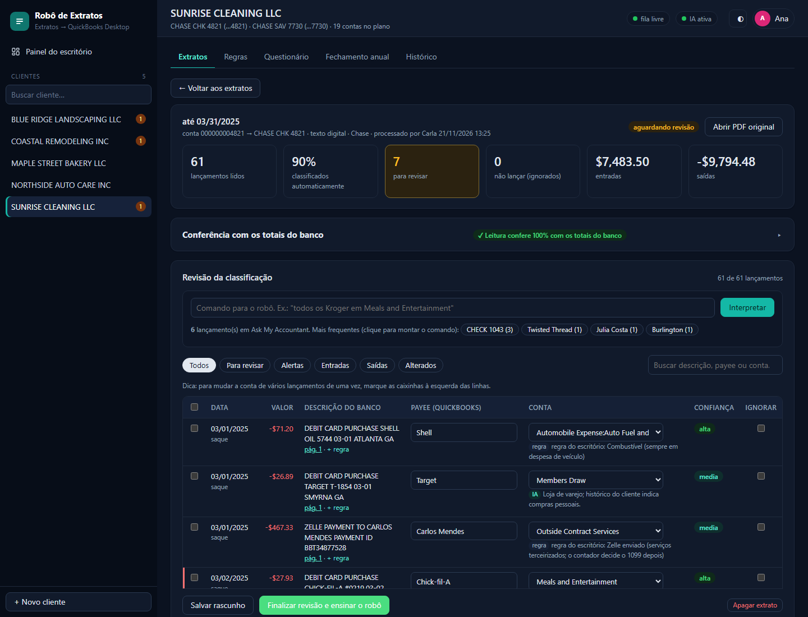
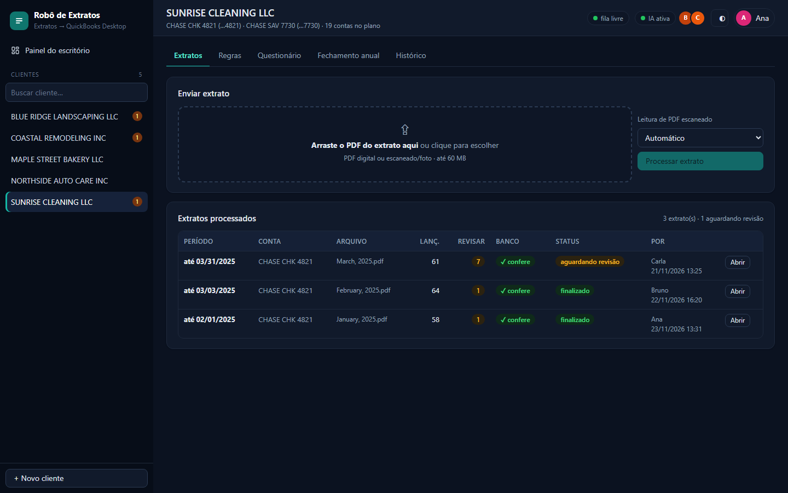
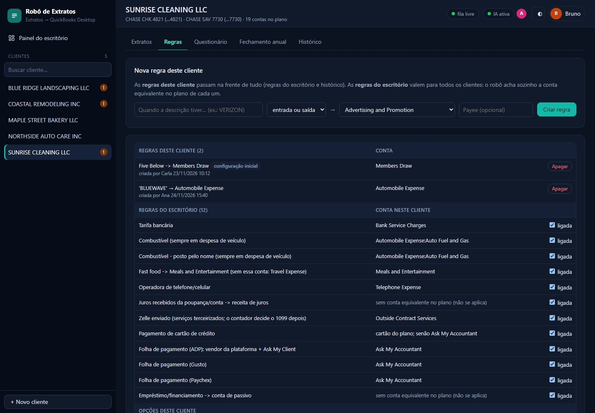
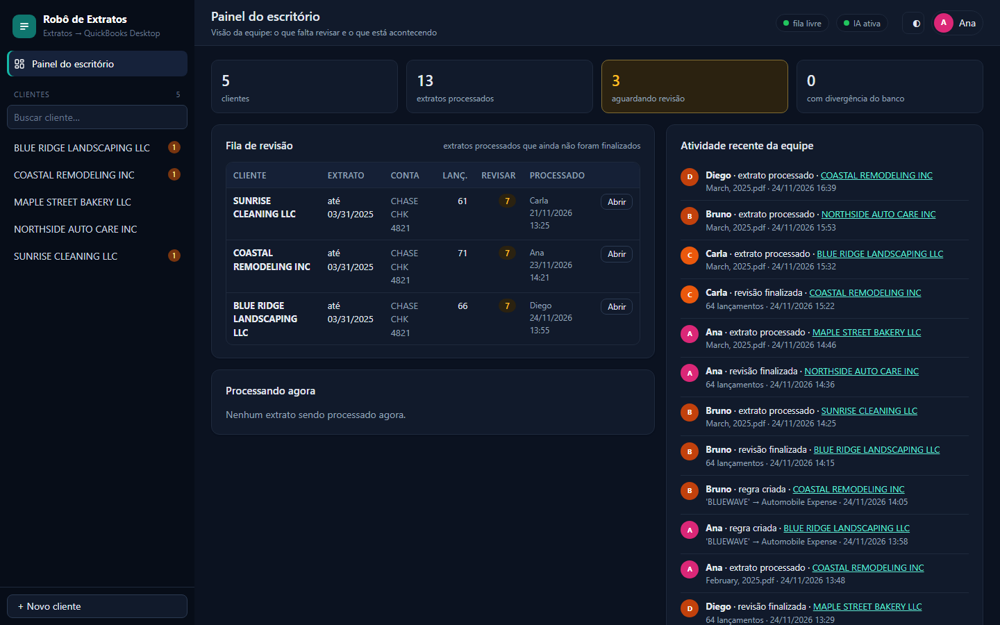
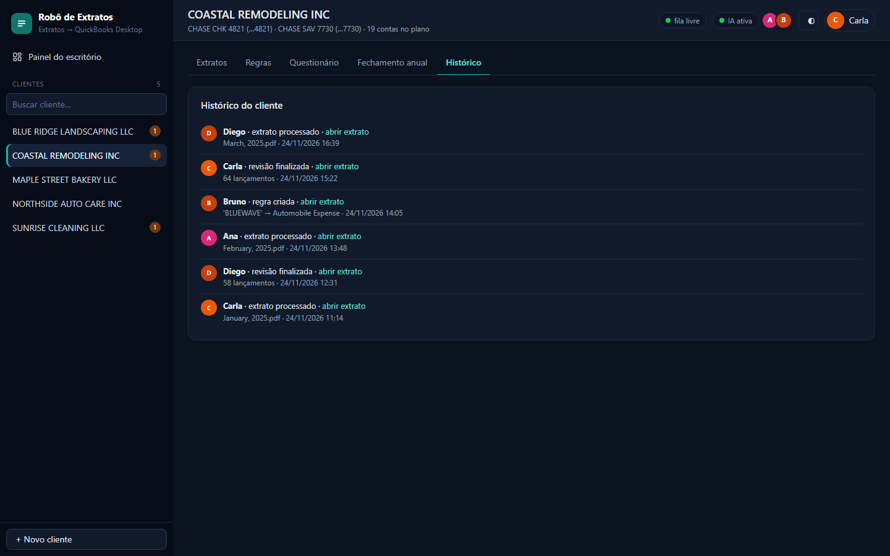
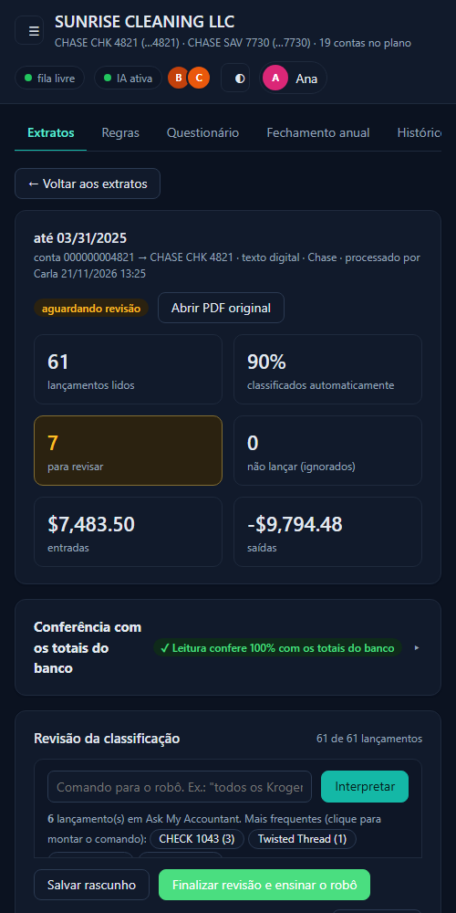
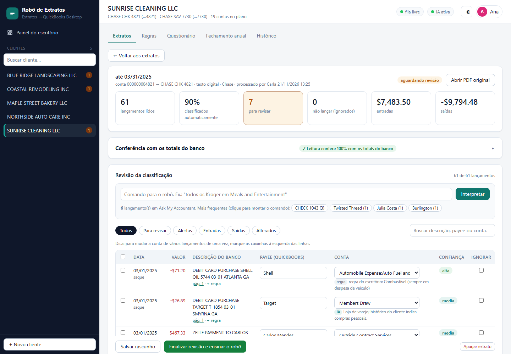

# Robô de Extratos

**Extratos bancários em PDF classificados com IA e prontos para importar no QuickBooks Desktop.**

O Robô de Extratos foi criado para um escritório de contabilidade nos Estados Unidos que atende dezenas de pequenas empresas. Todo mês, a equipe recebe os extratos bancários de cada cliente em PDF e precisa lançar cada transação na conta certa do plano de contas no QuickBooks Desktop. Antes, esse trabalho era feito linha por linha.

O robô lê o PDF, confere a leitura com os totais impressos pelo banco, classifica cada lançamento e gera os arquivos que o QuickBooks importa direto. O contador revisa só o que o robô não tem certeza.

> As telas desta página usam **empresas e transações fictícias**. Nenhum dado de cliente real aparece aqui.

---

## Resultados no uso real

Nos testes com extratos reais de clientes do escritório (vários meses e duas contas bancárias por cliente):

- **100% de conferência:** depósitos, saques e saldo final lidos do PDF bateram com os totais do banco em todos os extratos.
- **85% a 91% dos lançamentos classificados automaticamente**, com a revisão do contador concentrada em poucos casos por mês.
- **Importação sem erro** no QuickBooks Desktop, com o saldo do registro igual ao saldo final do extrato.
- **Transferências entre contas do mesmo cliente lançadas uma vez só**, mesmo aparecendo nos dois extratos.

---

## O que o sistema faz

### Leitura e conferência do extrato
- **PDF digital:** lê o texto direto. **PDF escaneado ou foto:** OCR local ou leitura por IA.
- **Conferência automática:** soma depósitos, saques, cheques e tarifas e compara com os totais impressos pelo banco e com o saldo final. Marca as linhas suspeitas antes de qualquer lançamento.
- **Extrato com várias contas:** separa cada conta (corrente, poupança) num extrato próprio.

### Classificação em camadas
A primeira camada que tiver a resposta decide:

1. **Regras do cliente**, criadas pelo contador na tela, sem programação.
2. **Regras do escritório**, que valem para todos os clientes. Cada regra encontra sozinha a conta equivalente no plano de cada cliente (por exemplo, "Auto Gas" num cliente e "Auto Fuel and Gas" em outro).
3. **Histórico do cliente:** o que a equipe já decidiu antes, importado do QuickBooks e aprendido a cada revisão.
4. **IA (Claude, da Anthropic)** para os casos novos, sempre limitada às contas que existem no plano do cliente.
5. **Conta de dúvida** (*Ask My Accountant*) para o que ninguém sabe: vai para revisão e não é lançado numa conta errada.

Cada lançamento mostra **por que** foi classificado daquele jeito ("regra do escritório: combustível", "equipe classificou 14x como…").

### Revisão pelo contador
- Filtros **Para revisar**, **Alertas**, **Entradas**, **Saídas** e **Alterados**.
- **Comando em linguagem natural:** "todos os Kroger em Meals and Entertainment".
- **Mudança em massa:** seleciona várias linhas e aplica a conta de uma vez.
- Ao **finalizar**, o robô aprende cada decisão para os próximos meses daquele cliente.

| Extratos do cliente | Regras do cliente e do escritório |
|---|---|
|  |  |

### Exportação para o QuickBooks Desktop
- **Arquivos IIF** prontos para *File › Utilities › Import*: primeiro os **vendors novos**, depois os **lançamentos**.
- **Payee resolvido com o cadastro do QuickBooks:** usa a grafia que já existe lá (inclusive nomes parecidos, como "Downtown Toyota" → "Toyota"). Vendor novo só é criado quando a política do escritório manda.
- **Duplicidade evitada:** avisa quando o mesmo PDF já foi processado e não lança duas vezes transferências entre contas do cliente.

### Feito para a equipe usar ao mesmo tempo
- **Painel do escritório:** extratos aguardando revisão de todos os clientes, o que está sendo processado e a atividade recente da equipe.
- **Presença:** mostra quem está com o mesmo extrato aberto. Duas pessoas podem revisar juntas: as alterações são juntadas linha por linha.
- **Fila de processamento:** vários extratos podem ser enviados ao mesmo tempo, sem travar o servidor.
- **Histórico** de quem processou, revisou, finalizou e criou cada regra.

| Histórico do cliente | No celular |
|---|---|
|  |  |

Tema claro e escuro:

---

## Segurança

O sistema roda no servidor do escritório e trata dados financeiros de clientes, por isso:

- **Acesso só pelo próprio servidor**, com proteção contra CSRF e DNS rebinding e cabeçalhos de segurança (CSP).
- **Envio de arquivos validado:** só aceita PDF, com limite de tamanho e de páginas.
- **IA contida:** a resposta só é aceita se a conta existir no plano do cliente. A IA nunca marca confiança "alta" sozinha, e textos com cara de instrução escondidos em memos bancários vão direto para revisão humana.
- **Planilhas protegidas** contra injeção de fórmulas.
- **Gravação atômica** e travas por cliente, para que dois contadores salvando ao mesmo tempo não percam dados.
- **Revisão humana antes de importar**, sempre com backup do QuickBooks.

---

## Tecnologias

Python · PyMuPDF · RapidOCR (ONNX Runtime) · OpenCV · API do Claude (Anthropic) · HTML/CSS/JavaScript · QuickBooks Desktop (IIF) · Windows Server

---

## Criador

**João Gabriel Dal Vesco Smaniotto**, idealização e desenvolvimento.

- E-mail: [jgdalvesco@gmail.com](mailto:jgdalvesco@gmail.com)
- WhatsApp: [+55 (49) 98505-6650](https://wa.me/5549985056650)

Interesse em automatizar a contabilidade do seu escritório: fale comigo.

---

QuickBooks é marca registrada da Intuit Inc. Este projeto é independente e não tem vínculo com a Intuit.

Este repositório apresenta o sistema; o código-fonte não é público.
© 2026 João Gabriel Dal Vesco Smaniotto. Todos os direitos reservados.
